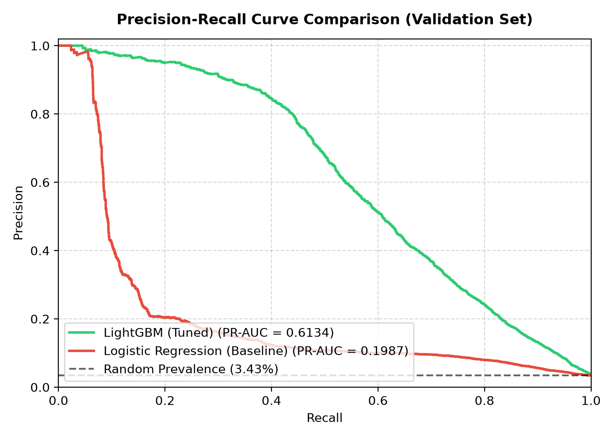
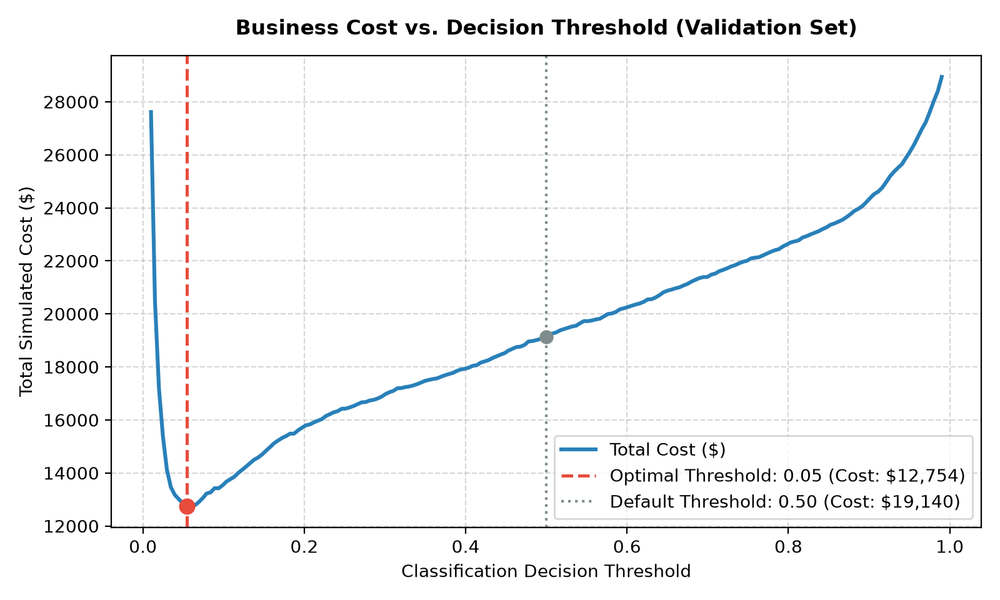
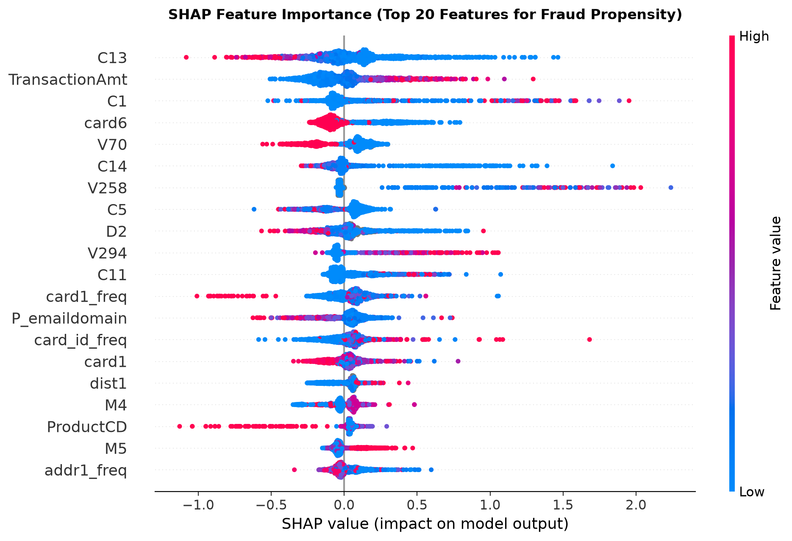
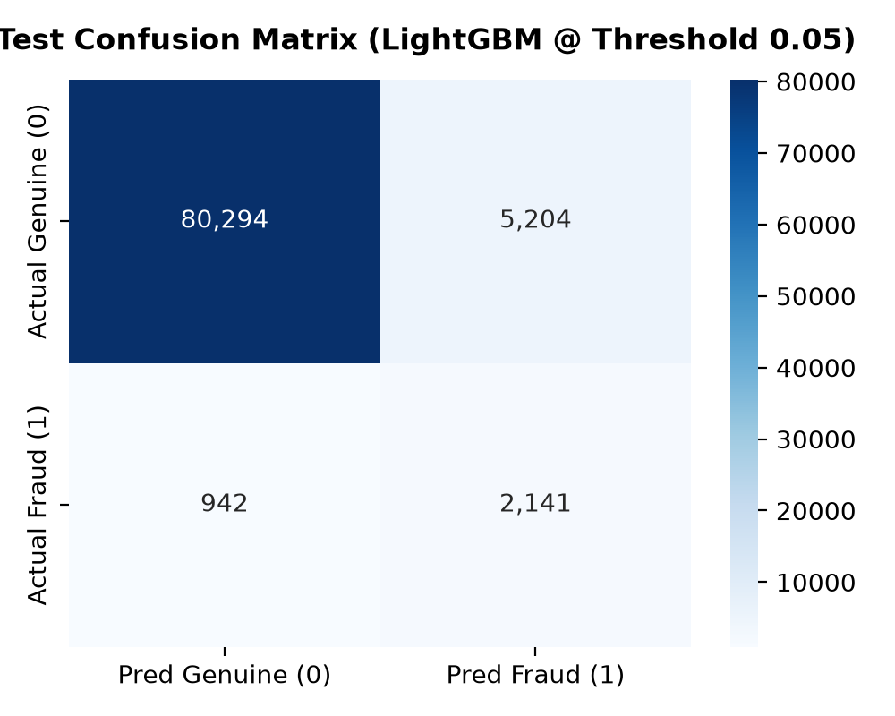

# Transaction Risk Engine: Production ML Fraud Detection Pipeline

[](https://python.org)
[](https://fastapi.tiangolo.com)
[](https://lightgbm.readthedocs.io)
[](https://streamlit.io)
[](https://docker.com)
[](LICENSE)

An end-to-end, cost-sensitive fraud detection engine built on **590,540 real-world payment transactions** (IEEE-CIS). Engineered with strict time-based splits to eliminate temporal leakage, cost-optimized operating thresholds ($Cost_{FN} = 10 \times Cost_{FP}$), explainable Tree SHAP diagnostics, a production FastAPI inference service (<15ms latency), an operations Streamlit dashboard, and Docker container orchestration.

---

## Key Business & Technical Results

On a strict **out-of-time holdout test set (88,581 transactions)** evaluated strictly once:

| Metric | Baseline (Logistic Regression) | Final Engine (LightGBM) | Relative Impact |
|:---|:---:|:---:|:---:|
| **PR-AUC (Primary)** | `0.1284` | **`0.5522`** | **+330.1% Improvement** |
| **ROC-AUC** | `0.7747` | **`0.9128`** | **+17.8% Improvement** |
| **Simulated Business Cost** | `$32,378.00` | **`$14,624.00`** | **-54.83% Cost Reduction** |
| **Net Financial Savings** | Reference ($0) | **`$17,754.00` Saved** | **Direct ROI on Holdout** |
| **Operating Threshold ($T^*)** | `0.5000` (Balanced) | **`0.0543` (Cost-Tuned)** | Minimum Expected Risk |
| **Recall at $T^*$** | `68.21%` | **`69.45%`** | Catches 2,141 / 3,083 Frauds |
| **Precision at $T^*$** | `5.30%` | **`29.15%`** | **5.5x Fewer False Alarms** |
| **Recall @ 80% Precision** | `0.00%` | **`35.94%`** | High-Confidence Auto-Decline |

---

## Resume Highlights (Ready for Applications)

> **Machine Learning Engineer / Data Scientist — Transaction Risk Engine**
> - Built an end-to-end, production fraud detection pipeline on 590K+ IEEE-CIS payment transactions, enforcing strict chronological splits (70/15/15) to prevent temporal data leakage.
> - Improved out-of-time **PR-AUC from 0.13 to 0.55 (+330%)** and cut simulated financial fraud loss by **54.8% ($17,754 net savings)** by optimizing decision thresholds against asymmetric business costs ($Cost_{FN} = 10 \times Cost_{FP}$).
> - Engineered an explainable microservice using **FastAPI** with Pydantic v2 schemas (<15ms scoring latency), dynamic Tree SHAP risk drivers, and a **Streamlit** operations dashboard for manual transaction review and batch CSV auditing.
> - Containerized the multi-service architecture using **Docker** and **Docker Compose**, backed by comprehensive Pytest suites and Render deployment blueprints.

---

## System Architecture

```mermaid
flowchart TD
    subgraph Data Layer
        A[IEEE-CIS Dataset<br>590,540 Transactions] --> B[Data Cleaning & Memory Downcasting<br>-47.9% RAM Reduction]
        B --> C[Strict Chronological Split<br>Train: 70% | Val: 15% | Test: 15%]
    end

    subgraph Feature Engineering & Training
        C --> D[Leak-Free Feature Pipeline<br>Temporal, Aggregations, Ratios, Out-of-Fold Frequency]
        D --> E[Model Benchmarking<br>Logistic Reg vs Class Weights vs Undersampling vs LightGBM]
        E --> F[Validation Cost Optimization<br>T* = 0.0543 on Cost FN=$10, FP=$1]
        F --> G[Explainability Layer<br>Global Tree SHAP + Real-Time Local Attributions]
    end

    subgraph Evaluation
        G --> H[Final Holdout Test Evaluation<br>PR-AUC: 0.5522 | Cost: $14,624]
    end

    subgraph Serving & Operations
        H --> I[FastAPI Scoring Service<br>/predict with Pydantic & Multi-Tier Decisions]
        H --> J[Streamlit Dashboard<br>Real-Time Presets, Batch CSV Audit, Executive KPIs]
        I --> K[Docker & Docker Compose<br>libgomp1 OpenMP Support & Render CI/CD]
        J --> K
    end
```

---

## Visual Reports & Model Insights

### 1. Precision-Recall & ROC Performance
PR-AUC is the gold standard for rare-positive fraud detection (3.5% prevalence). The final LightGBM model achieves a **0.5522 PR-AUC** (outperforming the baseline by 330%).
<p align="center">
  
</p>

### 2. Business Cost vs. Decision Threshold
Rather than defaulting to an arbitrary 0.50 cutoff, the threshold $T^* = 0.0543$ was mathematically derived by minimizing the asymmetric cost curve ($FN \times \$10 + FP \times \$1$), saving $17,754 on the holdout test set.
<p align="center">
  
</p>

### 3. Tree SHAP Feature Importance
Tree SHAP explains the exact non-linear drivers behind transaction flags. Top risk indicators include transaction velocity (`C13`, `C1`), spend deviation (`TransactionAmt`), card network (`card6`), and behavioral verification velocity (`V70`, `C14`).
<p align="center">
  
</p>

### 4. Holdout Test Confusion Matrix
At $T^* = 0.0543$, the model successfully blocks **2,141 high-risk fraudulent transactions** while keeping false positive investigator reviews manageable.
<p align="center">
  
</p>

---

## Repository Structure

```text
Transaction-Risk-Engine/
├── app/
│   ├── __init__.py
│   ├── api.py                    # Production FastAPI scoring service (Pydantic v2 schemas)
│   └── dashboard.py              # Streamlit operations & executive analytics dashboard
├── data/                         # Excluded from git (download instructions below)
│   ├── raw/
│   └── processed/
├── docs/
│   ├── explanations/             # Step-by-step interview guides (00 to 12)
│   └── interview_cheatsheet.md   # 1-page interview cheat sheet for recruiter/hiring manager screens
├── models/
│   ├── baseline_model.joblib     # Logistic regression pipeline
│   ├── best_lightgbm.joblib      # Production LightGBM model binary
│   └── feature_pipeline.joblib   # Serialized leak-free feature engineering pipeline
├── notebooks/
│   ├── 01_eda.ipynb              # Exploratory data analysis & fraud patterns
│   └── 02_modelling.ipynb        # Hyperparameter tuning & cost analysis
├── reports/                      # Diagnostic plots, JSON metrics, and SHAP artifacts
│   ├── baseline_metrics.json
│   ├── final_metrics.json
│   ├── cost_vs_threshold.png
│   ├── pr_curve.png
│   ├── final_confusion_matrix.png
│   ├── shap_summary.png
│   └── error_analysis.md
├── scripts/
│   ├── download_data.py          # Automated Kaggle API dataset downloader
│   └── prepare_data.py           # End-to-end data preparation workflow
├── src/
│   ├── config.py                 # Central configurations, random seeds, and cost parameters
│   ├── data.py                   # Data ingestion, downcasting (-47.9% RAM), and cleaning
│   └── features.py               # Feature engineering pipeline & transform_single()
├── tests/
│   ├── test_api.py               # API endpoint unit tests
│   ├── test_features.py          # Feature transformation assertions
│   └── test_splits.py            # Strict chronological boundary unit tests
├── Dockerfile                    # Multi-stage production container specification
├── docker-compose.yml            # Multi-service container orchestration (API + Dashboard)
├── render.yaml                   # Infrastructure-as-code cloud deployment blueprint
├── requirements.txt              # Pinned production Python dependencies
├── Implementation Plan.md        # Step-by-step technical progression plan
├── PRD.md                        # Product requirements document
└── README.md
```

---

## Quickstart & Local Setup

### 1. Prerequisites & Virtual Environment
```bash
# Clone the repository
git clone https://github.com/Lakshit2604/Transaction-Risk-Engine.git
cd Transaction-Risk-Engine

# Create and activate virtual environment
python3 -m venv .venv
source .venv/bin/activate

# Install dependencies
pip install -r requirements.txt
```

### 2. Download Dataset
Place your Kaggle API key at `~/.kaggle/kaggle.json` and download the IEEE-CIS dataset:
```bash
python scripts/download_data.py
```

### 3. Run Unit Tests
Verify pipeline integrity and test bounds:
```bash
pytest tests/ -v
```

### 4. Run the FastAPI Service Locally
```bash
uvicorn app.api:app --host 0.0.0.0 --port 8000 --reload
```
- Interactive Swagger API docs: `http://localhost:8000/docs`
- Healthcheck endpoint: `http://localhost:8000/health`
- Predict transaction: `POST http://localhost:8000/predict`

Example API payload:
```bash
curl -X POST "http://localhost:8000/predict" \
     -H "Content-Type: application/json" \
     -d '{
       "TransactionAmt": 450.00,
       "ProductCD": "W",
       "card1": 13926,
       "card2": 555.0,
       "card3": 150.0,
       "card4": "discover",
       "card5": 102.0,
       "card6": "credit",
       "addr1": 315.0,
       "addr2": 87.0,
       "P_emaildomain": "gmail.com",
       "C1": 1.0, "C2": 1.0, "C3": 0.0, "C4": 0.0, "C5": 0.0,
       "C6": 1.0, "C7": 0.0, "C8": 0.0, "C9": 1.0, "C10": 0.0,
       "C11": 1.0, "C12": 0.0, "C13": 1.0, "C14": 1.0,
       "D1": 14.0, "D4": 14.0, "D10": 13.0, "D15": 0.0,
       "V70": 0.0, "V127": 117.0, "V307": 117.0,
       "TransactionDT": 86400
     }'
```

### 5. Run the Streamlit Dashboard Locally
```bash
streamlit run app/dashboard.py
```
Access the dashboard at `http://localhost:8501`. Test single transactions using 1-click sample presets, batch-score CSV files, or review executive model performance charts.

---

## Docker & Container Execution

Run the complete decoupled microservice stack (FastAPI on `:8000` + Streamlit on `:8501`) with Docker Compose:
```bash
# Build and run with Docker Compose
docker compose up --build

# Run in detached mode
docker compose up -d

# Stop services
docker compose down
```

---

## Cloud Deployment (Render / Cloud Hosts)

The repository includes a declarative `render.yaml` Blueprint for 1-click deployment on Render:
1. Fork or push this repository to your GitHub account.
2. Log into [Render](https://render.com) and navigate to **Blueprints**.
3. Connect your repository; Render will automatically detect `render.yaml` and provision:
   - **`transaction-risk-api`**: FastAPI inference service on port 10000.
   - **`transaction-risk-dashboard`**: Streamlit visual interface on port 10000.

---

## Interview & Architecture Deep-Dive

For detailed technical interview preparation on design choices, statistical justifications, and failure modes, refer to:
- **[Interview Cheat Sheet](docs/interview_cheatsheet.md)**: 1-page condensed review of metric selection, leak prevention, threshold tuning, and error analysis.
- **[Step Explanations](docs/explanations/)**: Complete, step-by-step breakdown of every implementation phase (Steps 00 to 12).

---

## License

This project is licensed under the MIT License — see the [LICENSE](LICENSE) file for details.
